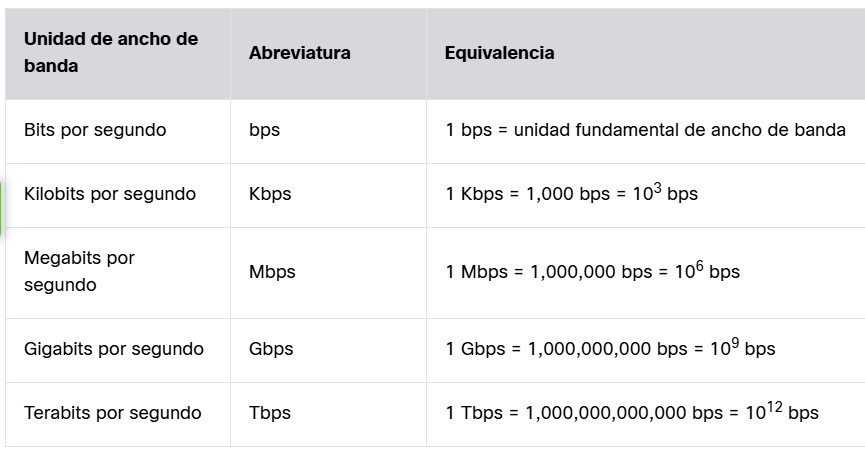

## 1. Introducción a las Redes
El internet es la red de redes; es el entorno invisible construido por una gran cantidad de redes que hacen posible el uso de servicios en línea. Existen redes locales de todo tipo de tamaños. Aquellas instaladas en oficinas o hogares se conocen como **SOHO** (*Small Office/Home Office*), permitiendo compartir recursos entre usuarios locales.

### Tipos de Redes
1. **Redes domésticas pequeñas:** Conectan algunas computadoras entre sí y a internet.
2. **Redes de oficinas pequeñas:** Permiten que una red pequeña se conecte a una red corporativa y acceda a recursos compartidos centralizados.
3. **Redes medianas y grandes:** Abarcan múltiples ubicaciones con miles de hosts interconectados.
4. **Redes mundiales:** Red de redes que conecta millones de dispositivos a escala global.

---

## 2. Dispositivos y Tecnologías de Red
* **Etiquetas RFID:** Dispositivos de identificación por radiofrecuencia (*Radio Frequency Identification*).

---

## 3. Unidades de Datos y Codificación
* **El bit:** Unidad mínima de datos en informática (*binary digit*), que opera con dos valores posibles: `0` y `1`. Las computadoras utilizan el sistema binario para interpretar letras, números y caracteres especiales.
* **ASCII:** Estándar tradicional de codificación (*American Standard Code for Information Interchange*), donde cada carácter se representa mediante 8 bits (un byte). Permite la comunicación con los periféricos de la computadora; cada orden o pulsación de tecla utiliza un código en bits para ejecutar la acción deseada.
* **UTF-8:** Estándar de codificación de caracteres utilizado de forma predominante en la actualidad.

---

## 4. Métodos Comunes de Transmisión de Datos
Es la forma en la que se envían los datos (una serie de bits) en formato de señales. Estos se dividen según el medio de envío de la señal:
1. **Eléctricos:** Normalmente se envían señales eléctricas a través de cables de cobre.
2. **Ópticos:** Se envían señales eléctricas de luz por pulsos.
3. **Inalámbricos:** Por medio de ondas de transmisión como el de radio, microondas o infrarrojos.

---

## 5. Ancho de Banda
El ancho de banda vendría a ser la capacidad de un medio para transferir datos, como el ancho de un canal o un río para transportar agua. Las medidas comunes de ancho de banda son:
- Miles de bits por segundo (kbps)
- Millones de bits por segundo (mbps)
- Miles de millones de bits por segundo (gbps)

---

## 6. Rendimiento y Latencia
Al igual que el ancho de banda, el rendimiento es la medida de la transferencia de bits por los medios durante un período determinado. Sin embargo, debido a diferentes factores, el rendimiento generalmente no coincide con el ancho de banda especificado. Muchos factores influyen en el rendimiento, incluidos los siguientes:

1. La cantidad de datos que se envían y reciben por la conexión.
2. Los tipos de datos que se transmiten.
3. La latencia creada por la cantidad de dispositivos de red encontrados entre origen y destino.

* **El concepto de latencia:** Se refiere al tiempo, incluidas las demoras, que les toma a los datos transferirse desde un punto determinado hasta otro.

* **Consideración de las mediciones:** Las mediciones de rendimiento no consideran la validez ni la utilidad de los bits que se transmiten y reciben. Muchos mensajes recibidos a través de la red no están destinados a aplicaciones de usuario específicas. Un ejemplo serían los mensajes de control de la red que regulan el tráfico y corrigen errores.

* **Regla del cuello de botella:** En una internetwork o una red con múltiples segmentos, el rendimiento no puede ser más rápido que el enlace más lento de la ruta desde el dispositivo de origen hasta el de destino. Incluso si todos los segmentos o gran parte de ellos tienen un ancho de banda elevado, solo se necesita un segmento en la ruta con un ancho de banda inferior para disminuir el rendimiento de toda la red.

* **Pruebas:** Existen muchas pruebas de velocidad en línea que pueden revelar el rendimiento de una conexión a Internet.